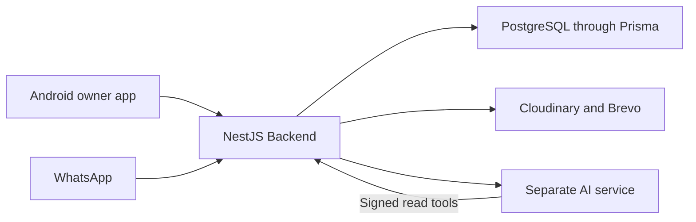

# Brandora Backend

Brandora Backend is the NestJS API for an owner-managed retail business platform.
It owns authorization, business data, product variants, audited stock, Excel
imports, customer conversations and owner-approved orders. Android consumes the
owner API; a separate AI service answers customer messages through signed,
read-only Backend tools.

## Features and stack

- JWT authentication, rotating refresh sessions, email OTP recovery and shared
  PostgreSQL Auth rate limits.
- Multi-business OWNER membership, profiles, preferences, weekly hours and categories.
- Product/Variant metadata, category filtering, Main/Gallery images and variant stock.
- Synchronous Excel analysis, mapping, validation, preview, execution and history.
- Customers/conversations, owner replies/handoff, WhatsApp webhooks/sending and
  persisted AI replies/recovery.
- Owner order creation, approval/rejection, snapshot pricing and atomic stock deduction.

TypeScript, NestJS 11, Prisma 7.10.1 and PostgreSQL provide the core. Cloudinary
hosts product images; Brevo HTTPS delivers recovery email; Meta and the separate
AI service are optional integrations. Provider readiness and Android UI completion
are separate from Backend implementation. AI/WhatsApp are disabled by default.



## Local installation

Use Node.js >=22.12, npm and an explicitly disposable local PostgreSQL target.
Install the checked-in versions:

```sh
npm ci
```

Create a private `.env` from [.env.example](.env.example) only if one does not
already exist. Configure local DATABASE_URL plus JWT_SECRET (at least 32 UTF-8
bytes), JWT_ISSUER and JWT_AUDIENCE. Keep actual credentials out of Git. Optional
providers are configured separately in [deployment](docs/deployment.md).

After confirming the fresh local target and reviewing the committed migration
guards:

```sh
npm run prisma:validate
npm run prisma:generate
npm run prisma:deploy
npm run start:dev
```

Migration deployment is explicit: build/start never migrates automatically.
Existing databases need a compatibility/backup review; reset/db push and historical
cleanup SQL are not shortcuts. The demo seed is localhost-only but does not grant
OWNER memberships. See [database](docs/database.md) and [testing](docs/testing.md).

## Build and verification

```sh
npm run build
npm run start:prod
```

Build generates Prisma Client and compiles NestJS; production start runs
`node dist/main.js` on the configured PORT (3000 locally). Confirm actual host
build/start settings and release compatibility before deployment.

```sh
npm test
npm run test:businesses
```

These build and run maintained mocked regressions/native Business HTTP checks.
Real PostgreSQL verification uses separate scripts and disposable targets; see
[testing](docs/testing.md). Historical counts are not new test results.

## Documentation

| Topic                                         | Guide                                                                                    |
| --------------------------------------------- | ---------------------------------------------------------------------------------------- |
| API entry point and detailed contracts        | [API guide](docs/api-guide.md)                                                           |
| Modules, providers and request lifecycle      | [Architecture](docs/architecture.md)                                                     |
| Models, ER diagram and migrations             | [Database](docs/database.md)                                                             |
| Sessions, OTP, ownership and security         | [Authentication](docs/authentication.md)                                                 |
| Catalog, inventory, conversations and Orders  | [Business rules](docs/business-rules.md)                                                 |
| Upload-to-execution workflow                  | [Excel imports](docs/excel-import-flow.md)                                               |
| AI orchestration and signed boundary          | [AI integration](docs/ai-integration.md) / [cross-service contract](docs/ai-contract.md) |
| Separate loopback AI harness                  | [Local AI testing](docs/ai-local-testing.md)                                             |
| Client workflows and serialization            | [Android integration](docs/android-integration.md)                                       |
| Environment, providers and operational limits | [Deployment](docs/deployment.md)                                                         |
| Commands, fixtures and verification evidence  | [Testing](docs/testing.md)                                                               |
| Stable errors and consumer recovery           | [API errors](docs/api-errors.md)                                                         |

Swagger/OpenAPI is the next implementation task; no Swagger URL exists yet.
Detailed API and Android contracts remain available until equivalent coverage is
verified. Durable import storage, resumable execution, public order completion/
post-approval cancellation, media download, push notifications and image recognition
are not implemented. Do not infer live deployment, delivery or model acceptance
from local source or mocked tests.
