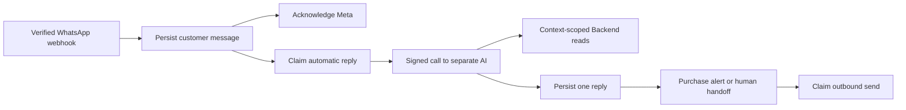

# AI integration

This guide describes the Backend implementation. The independently maintained
[AI contract](ai-contract.md) remains the negotiated cross-service reference;
its implementation-alignment section records discrepancies requiring owner
review. No external AI checkout, live model or deployed provider was verified
by this documentation work.

## Implemented paths and activation

AiModule binds `AiConversationStore` to `ConversationsAiStore` from
ConversationsModule through useExisting. The persistent adapter exists; claims
that it is still an unavailable stub are obsolete. AI calls remain disabled
unless AI_INTEGRATION_ENABLED is exactly `true` and credentials are valid.
WhatsApp is independently disabled by default.

The normal customer path is:



The reply orchestration is launched without awaiting AI delivery in the webhook
response. Database persistence errors prevent successful acknowledgment. A 200
acknowledges stored input, not completed AI work or customer delivery.

Two Backend endpoints are registered:

| Endpoint                                  | Boundary                                                                                                                                                                      |
| ----------------------------------------- | ----------------------------------------------------------------------------------------------------------------------------------------------------------------------------- |
| POST `/businesses/:businessId/ai/respond` | Owner JWT/membership; IDs refer to a persisted source message; returns a validated stored response. It is an alternative trigger, not a direct Android-to-AI credential flow. |
| POST `/internal/ai/data`                  | Distinct inbound service token and signed context through AiInternalGuard; exempt only from owner JWT.                                                                        |

Android must not hold service keys, fabricate history or invoke the separate AI
service directly. Whether the owner trigger belongs in a particular UI is a
client/product decision; its existence must not be hidden from API documentation.

The owner trigger accepts only the two persisted UUIDs, for example:

```json
{
  "conversationId": "11111111-1111-4111-8111-111111111111",
  "messageId": "22222222-2222-4222-8222-222222222222"
}
```

Use actual returned IDs from the owned Business, not these example values.
Success is 200 with intent/reply/requiresReview/orderCandidate; disabled or
unconfigured integration returns a safe 503. The request cannot supply message
text, history or an authoritative customer/business identity.

## Signed request and read tools

The Backend reads and attests a scoped CUSTOMER/TEXT message, then serializes
businessId, customerId, conversationId, messageId and stored message text. It
sends X-Internal-Token using AI_SERVICE_TOKEN and an RS256 X-AI-Context. The
context binds the four identities, exact-body SHA-256, issuer/audience, read
scope, issuance and a 60-second expiry. Re-attestation after the external call
rejects a changed source before saving a reply. No owner token is forwarded.

AI_SERVICE_TOKEN and BACKEND_SERVICE_TOKEN are distinct directional credentials;
Backend holds the private RSA key (at least 2048 bits), AI receives the public key.
Service values are printable non-whitespace ASCII, 32–4096 characters. AI_BASE_URL
is an HTTPS origin or explicit HTTP loopback, without userinfo/path/query/fragment.
Redirects are rejected. Invalid/disabled settings fail closed with a safe 503.

Internal tools are read-only and scoped from signed context, never a model-supplied
businessId. Arguments have exact required/optional keys and strict UUID/number
validation; unknown keys, URLs and write tools are rejected.

| Backend tool             | Scope / input                                                                  |
| ------------------------ | ------------------------------------------------------------------------------ |
| get_products             | Signed Business; optional numeric limit/offset.                                |
| get_product_details      | Scoped productId.                                                              |
| get_product_variants     | Scoped productId; optional numeric limit/offset.                               |
| get_variant_details      | Scoped productId and variantId.                                                |
| get_conversation_history | Same signed conversationId; optional numeric limit/offset.                     |
| get_business_info        | Signed Business profile, settings and working hours; compatibility capability. |

The Backend supports all six. The separate canonical AI consumer's recorded
five-tool allowlist excludes get_business_info; expanding its negotiated use
requires alignment, not an assumption based on Backend availability. Contexts
can be reused for several reads during their lifetime; this is not durable
anti-replay authorization or permission to write.

## Limits and response validation

| Backend boundary        | Implemented limit                                                              |
| ----------------------- | ------------------------------------------------------------------------------ |
| Source customer text    | 2,000 Unicode code points; nonblank persisted CUSTOMER/TEXT only.              |
| Outbound AI operation   | 30 seconds including body reads; no automatic provider retry.                  |
| AI response JSON        | 65,536 serialized bytes; exactly intent/reply/requiresReview/orderCandidate.   |
| Accepted intent         | INQUIRY, PURCHASE_INTENT or OTHER; CONFIRMED_ORDER is rejected at runtime.     |
| Accepted reply          | Nonblank; at most 20,000 code points before outbound-message handling.         |
| Candidate               | Must be null; no AI write tool creates/approves an order.                      |
| Internal data response  | At most 131,072 serialized bytes; pagination limit 1–100, default 20/0.        |
| Stored outbound message | At most 4,096 code points; longer AI replies use ellipsis/truncation metadata. |

Previously recorded AI-side budgets were a 25-second total deadline, five seconds
per Backend call, at most twelve request-local calls, retrieval bounds of eight
calls/100 records/five seconds, and history bounds of three pages/sixty messages/
12,000 characters/five seconds. Those external implementation assertions require
AI-owner verification; they are not newly measured or enforced by all Backend
code paths. Keep the AI deadline below the Backend's fixed deadline.

## History and compatibility

The adapter reads the same Business/Customer/Conversation strictly before the
source timestamp, orders by createdAt descending then id descending, and returns
a source-boundary hash. Entire current/future timestamps are excluded. Oversized
history text is null. The validator checks shape, IDs, ordering and CUSTOMER
timestamp ambiguity within a page. The hash is not a retained MVCC transaction
or content digest over all pages; stronger cross-page guarantees remain an
[explicit contract-alignment issue](ai-contract.md#implementation-alignment-requiring-owner-review).
Do not present UUID ordering as proof of causality.

Product/Variant data comes through existing scoped services. Prices remain decimal
strings/null; Variant responses retain productId and catalogItemId. Active image
metadata may be present, but there is no image-write tool or image recognition.
External typed image consumption must be agreed separately; see
[image handoff](product-images.md#upgrade-and-android-handoff).

## Reply persistence, handoff and recovery

Message.replyToMessageId uniqueness permits at most one persisted reply per source
message. Claims coordinate callers; a crashed/expired generation attempt can be
retried, so this is not exactly-once model invocation or delivery. The adapter
returns the first saved reply on replay. Backend fallback/non-text replies also
use persisted message identity.

PURCHASE_INTENT records the newest purchase alert and notifies the owner through
LoggingOwnerNotifier; no order or stock change occurs. requiresReview hands off
after persisting the last reply. Two consecutive fallback replies trigger
AI_UNAVAILABLE; oversized source text triggers MESSAGE_TOO_LONG. Owner takeover
and replies disable automatic AI until re-enabled. The notifier logs IDs/reasons;
there is no push-notification implementation.

Recovery runs on startup and every REPLY_RECOVERY_SECONDS (default 30; nonpositive
is off), requires WhatsApp enabled, and considers a fifteen-minute window with a
ten-second grace period and batches of fifty. AI claims expire after two minutes,
with at most two attempts. Automatic recovery replies must still be newest in
their conversation; owner messages follow their own send path.

WhatsAppSenderService claims sends and permits at most three attempts: immediate,
then roughly thirty seconds and two more minutes through recovery. Policy permits
retry for 429/5xx and pre-connection DNS/refusal failures. Timeouts or interrupted
ambiguous sends can become FAILED instead of being resent; stale pending messages
also expire. A customer can miss a reply. Do not claim that every restart completes
delivery or that arbitrary external failures guarantee exactly-once delivery.
Delivery reports move status forward; a later delivered/read report can establish
delivery after failure. See [WhatsApp](whatsapp-api.md).

Orders are owner-managed: creation snapshots data without stock deduction;
approval rechecks and deducts stock transactionally; notification follows commit.
See [Orders](orders-api.md) and [business rules](business-rules.md).

## Verification and operational boundaries

### Local persistent-path exercise

The following maintained tools exercise AppModule with a fake AI, unlike the
separate synthetic-context runner. Review their inputs first and use only an
explicit disposable local database with an owned Business and linked test number:

```sh
node verification/tools/make-ai-dev-secrets.cjs
npm run start:dev
node verification/tools/fake-ai-service.cjs
node verification/tools/send-whatsapp-webhook.cjs "Test product question"
```

Run the server and fake service in separate terminals. The secrets helper writes
private test configuration to `.env` and `.tmp/ai-dev/ai.env`; it is not a
production setup command and was not run by documentation maintenance. Load the
reviewed local configuration for each process. No real Meta send is needed in
dry run. A separate real AI process can replace the fake only after explicit
configuration/acceptance; no live model success is implied.

### Acceptance coverage

Use [local AI testing](ai-local-testing.md) for the separate synthetic loopback
runner and [testing](testing.md) for mocked/real-PostgreSQL acceptance layers.
Historical acceptance maps include duplicate webhooks, claim races, source binding,
history isolation/cutoff, purchase alerts, price changes, concurrent approvals,
handoff and restart states. Test case numbers are not stable API identifiers.

Live model behavior, external client parsing, Meta delivery, provider credentials,
ingress provenance and current deployment are separate owner acceptance items.
No source, schema, provider configuration or external service was changed by
this consolidation.
