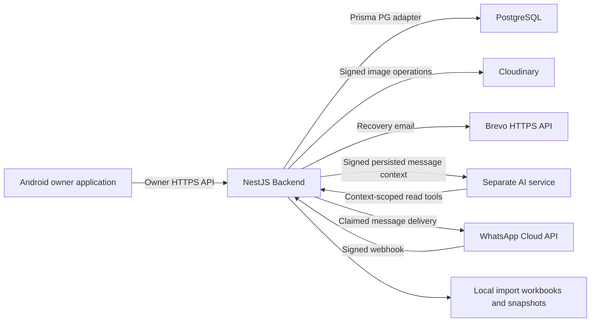
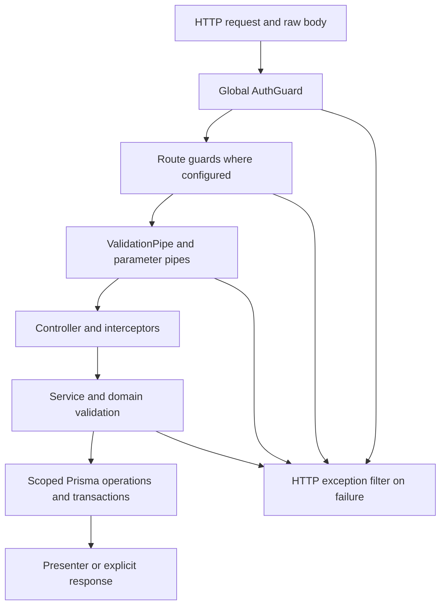

# Backend architecture

Brandora Backend owns business authorization, relational data, inventory,
imports, conversations and owner-managed orders. Android is an API client; the
separate AI service interprets messages through a signed, read-only tool boundary.
Neither client decides authoritative prices, stock, tenant scope or order state.

## System boundaries

Provider arrows describe implemented capabilities, not proof of live credentials,
deployment or delivery. AI and WhatsApp are disabled by default. See
[deployment](deployment.md) and [AI integration](ai-integration.md).

## Modules and providers

`AppModule` composes the modules below and a global ConfigModule. The current
source contains 17 module files, including AppModule. Configuration validates a
PostgreSQL DATABASE_URL and PORT; JWT configuration has separate startup checks.

| Module               | Responsibility / important dependencies                                                                                             |
| -------------------- | ----------------------------------------------------------------------------------------------------------------------------------- |
| PrismaModule         | Exports PrismaService using the generated client and PG adapter; connects during module initialization and disconnects on shutdown. |
| AuthModule           | Registers the global AuthGuard, JWT provider, sessions, PostgreSQL rate store and Brevo mailer.                                     |
| BusinessesModule     | Profiles, memberships, settings and working hours; imports ProductsModule for business existence checks.                            |
| CategoriesModule     | Scoped category CRUD; imports ProductsModule for business existence checks.                                                         |
| ProductsModule       | Product metadata, ProductAccessService, images and Cloudinary transport; imports PrismaModule and exports product/access services.  |
| VariantsModule       | Variant lifecycle/options/pricing; reuses ProductsModule access and locking.                                                        |
| InventoryModule      | Scoped variant stock and movement audit; reuses ProductAccessService.                                                               |
| ImportsModule        | Workbook analysis, mapping, validation, planning and execution; imports ProductsModule and InventoryModule.                         |
| CustomersModule      | Scoped customer reads and internal phone-based upsert; reuses ProductAccessService.                                                 |
| MessagesModule       | Message persistence, delivery states and AI/send claims; exports messaging services.                                                |
| ConversationsModule  | Customer/channel conversations, history, handoff and ConversationsAiStore; uses Customers, Messages and WhatsAppSender modules.     |
| AiModule             | Signed AI calls and internal read tools; uses Products, Variants, Businesses and Conversations modules.                             |
| WhatsAppSenderModule | WhatsApp settings and outbound message transport; uses MessagesModule and PrismaModule.                                             |
| AiRepliesModule      | Automatic reply orchestration, recovery and owner notifications; uses AI, Conversations, Messages and WhatsAppSender modules.       |
| WhatsAppModule       | Number linkage and signed inbound webhooks; invokes AiRepliesModule after persistence.                                              |
| OrdersModule         | Owner order creation/approval/rejection and customer notification; uses Products, Variants, Inventory and WhatsAppSender modules.   |

Important injection bindings are:

- `APP_GUARD -> AuthGuard` through `useExisting`.
- `AuthRateStore -> PostgresAuthRateStore` and
  `PasswordResetMailer -> BrevoPasswordResetMailer` through `useClass`.
- `AiConversationStore -> ConversationsAiStore` through `useExisting`.
- `ImportFileStorage -> LocalImportFileStorage` through `useExisting`.
- `OWNER_NOTIFIER -> LoggingOwnerNotifier`; this logs owner alerts. It is not a
  push-notification, Firebase or FCM implementation.

The approved ProductAccessService reuse is intentional. Categories, Imports,
Businesses, Customers and Inventory import ProductsModule rather than introducing
a new access module. Its existence checks are not authorization checks. The
global guard establishes access; services and composite foreign keys preserve
business scope. Static local module-import inspection found no cycle at the
2026-11-25 documentation baseline.

## HTTP request lifecycle

Interceptors wrap controller execution; the diagram summarizes boundaries rather
than every Nest lifecycle hook. Guards run before DTO validation. Validation
transforms supported inputs, whitelists properties and rejects unknown fields.
Raw request bytes are retained for WhatsApp signature verification.

The registered inventory is 67 routes: 57 JWT-protected, one separately guarded
internal AI route and nine public-policy routes. The AI route is exempt from
owner JWT only; its service-token/context guard is mandatory. WhatsApp webhooks
use verify-token/raw-body signature checks. There is no `/api` prefix, health
endpoint or implemented Swagger URL. The separate `/dev/ai/respond` runner is
not imported by AppModule.

## Transactions and external operations

Transaction guarantees are operation-specific. Business, Category, Product and
Inventory list snapshots use repeatable-read where implemented; do not assume
every count/page pair uses a transaction. Imports execute serializable product
groups. Inventory and lifecycle writers lock the scoped parent Product first.
Order approval commits its status and stock deductions together.

PostgreSQL cannot atomically commit with Cloudinary, email, AI or Meta. Image
compensation retains recoverable metadata. Order notification follows the order
commit and does not undo it. Ambiguous sends can fail permanently to avoid a
duplicate. Import execution is synchronous and has no durable crash takeover.

See [business rules](business-rules.md), [imports](excel-import-flow.md),
[authentication](authentication.md), [database](database.md) and
[error handling](api-errors.md).
