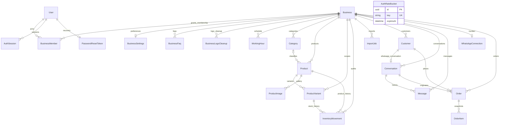

# Database design and migrations

[schema.prisma](../prisma/schema.prisma) defines the current Prisma model.
[Migration history](../prisma/migrations) supplies additional SQL constraints
that Prisma cannot represent. There are 20 models and 19 committed migrations
at the 2026-11-25 baseline. These counts do not establish any deployed database's
applied history or compatibility.

The 2026-11-27 implementation adds two models (BusinessFaq and BusinessLogoCleanup)
and one additive migration for owner policies, the store logo and User.name.
That is 22 source models and 20 migration directories including the new
migration, not evidence of deployed schema changes. User photos are not added.
Business logo cleanup keeps provider identities internal. Delivery fee has a
nonnegative database CHECK; FAQ position has a nonnegative CHECK.

## Models

UUID primary keys are used except where a parent identity is the primary key.
Tenant-owned rows carry businessId; scoped relations use composite tenant keys
where shown in the schema. Deletes generally restrict rather than cascade.

| Model               | Purpose, keys and relationships                                                                                                        |
| ------------------- | -------------------------------------------------------------------------------------------------------------------------------------- |
| Business            | Tenant root for memberships, catalog, imports, stock, customers, chats, number linkage and orders.                                     |
| User                | Unique normalized email, password hash and authVersion; has memberships, sessions and an optional reset token.                         |
| BusinessMember      | User/Business join; unique `(userId, businessId)`; role is OWNER with an independent isActive flag.                                    |
| AuthSession         | User FK; unique tokenFamilyId and refreshTokenHash; bounded rotation history, fixed expiry and revocation.                             |
| PasswordResetToken  | userId is PK/FK; one current reset record per User; unique HMAC tokenHash, expiry, consumption and delivery state.                     |
| AuthRateBucket      | Independent hashed rate-limit key, unique key and expiry index; no User or Business FK.                                                |
| BusinessSettings    | businessId is PK/FK; zero or one preferences row per Business.                                                                         |
| BusinessFaq         | Scoped owner question/answer with active flag and stable position/UUID ordering.                                                       |
| BusinessLogoCleanup | Internal provider cleanup identity and lifecycle; Business FK; never exposed to clients.                                               |
| WorkingHour         | Business FK; unique `(businessId, dayOfWeek)`; seven-day completeness is an API rule, not the relation cardinality.                    |
| Category            | Business FK and unique `(businessId, id)` tenant key; normalized-name uniqueness is SQL-only.                                          |
| Product             | Business FK; optional scoped Category FK; nullable externalKey unique within Business; JSON options/attributes and nullable basePrice. |
| ProductVariant      | Business and scoped Product FKs; SKU unique within Business; optionValues unique within Product; owns stock.                           |
| ProductImage        | Scoped Product FK; unique publicId; lifecycle/provider metadata and ordered gallery position. No direct Variant relation.              |
| InventoryMovement   | Business, scoped Product and scoped Variant FKs; quantity/tracking snapshots and operation references.                                 |
| ImportJob           | Business FK; workbook metadata, lifecycle, counters, saved mapping and internal failure information.                                   |
| Customer            | Business FK; unique `(businessId, phone)` and tenant key `(businessId, id)`.                                                           |
| Conversation        | Business and scoped Customer FKs; unique `(businessId, customerId, channel)`; AI/handoff and forward-only message times.               |
| Message             | Business and scoped Conversation FKs; unique nullable externalMessageId/replyToMessageId; delivery and recovery metadata.              |
| WhatsAppConnection  | Unique Business FK and unique phoneNumberId; one optional number link per Business and one Business per number.                        |
| Order               | Business, scoped Customer and scoped Conversation FKs; unique sourceMessageId; price/status snapshots and scoped tenant key.           |
| OrderItem           | Scoped Order FK; unique `(orderId, position)`; copied product/options/price/quantity values.                                           |

## Entity relationships

The diagram shows current database relationships, including optional children.
Customer-to-Conversation is at most one for the current WHATSAPP-only channel
enum and composite uniqueness; adding channels could permit one per channel.
The API requires 1–50 OrderItems, while a foreign key alone permits zero children.

OrderItem.productId/variantId are snapshot identifiers, deliberately without
Product/Variant FKs. Order.sourceMessageId, Conversation.purchaseMessageId and
Message.replyToMessageId are UUID fields without declared Message relations.
Creator/approver UUIDs on Order are not User FKs. Do not draw those as database
relations. Application validation and uniqueness still constrain their use.

## Constraints and tenant isolation

### Represented in Prisma

- Composite relations prevent assigning foreign Category, Product, Variant,
  Customer, Conversation or Order identities across businesses.
- Nullable Product externalKey and Variant SKU are business-scoped unique keys;
  PostgreSQL allows multiple nulls. Inactive rows retain occupied identities.
- `(businessId, productId, optionValues)` reserves every Variant combination,
  including inactive variants. JSONB equality ignores object-key order and treats
  numerically equal JSON numbers equally; it does not fold string case.
- Message IDs, reply identities, order source messages and number links have
  separate uniqueness rules. Unique nullable fields permit multiple nulls.
- Business/time, status/time, parent and operation-reference indexes support
  scoped lists, recovery scans and idempotency lookups; see the schema for exact
  column order and generated names.

### Maintained in migration SQL

- Category names must be nonblank and are unique per Business after whitespace
  normalization and case-insensitive comparison.
- Product/Variant options and attributes have JSON shape checks. Application
  validation further bounds definitions, nesting and serialized byte sizes.
- Tracked Variant stock is nonnegative/non-null; untracked stock is null.
  Movement CHECKs enforce valid tracking snapshots, quantity arithmetic,
  references and order-movement semantics.
- The partial `InventoryMovement_order_line_key` index reserves an ORDER_LINE
  reference per Business and movement type, independently of Variant identity.
- ACTIVE ProductImage positions are unique per Product, and position is 0..4.
  UPLOADING capacity is also enforced by application reservation under a Product
  lock; the ACTIVE index alone does not count reservations.
- Auth migrations enforce normalized email and relevant token/session bounds.

The option-combination index is a B-tree index on JSONB, not a hash-only identity.
Application selections are limited to 1,500 UTF-8 JSON bytes, including escaping;
Product definitions must bound every possible selection. This protects index
size and preserves real equality rather than accepting hash collisions.

SQL checks, expression indexes and partial indexes must survive future changes.
A representable Prisma schema diff is not proof that all SQL-only constraints
exist. Test their behavior on an isolated database as well.

## Transactional invariants

Product/Variant/stock writers share a scoped parent Product lock. Import groups
also take an advisory identity lock for first creation and use serializable
transactions. A group commits its Category, Product, Variants and stock audits
together. Other groups may already have committed when a workbook fails.

Orders copy prices at creation, then revalidate them at approval. Approval status
and stock deductions commit together. External customer notification follows the
commit and cannot roll it back. Image metadata changes commit separately from
Cloudinary operations and retain recovery state after ambiguous failures.

## Migration strategy

Use checked-in migrations; do not rewrite applied history, infer production
compatibility from a local schema, or use db push/reset to bypass a guard. Build
and startup do not run migrations automatically.

The historical inventory migration removes parent stock columns and refuses
incompatible legacy stock/history. The Product rename changes physical table and
column names in place. The gallery migration preserves existing assets/metadata,
backfills order, and refuses more than five ACTIVE/UPLOADING images. These
operations require target-specific compatibility review and may require a
maintenance window. Old/new physical-name readers and old color-image writers
must not overlap incompatible schemas.

Prepare a tested artifact and recoverable backup, confirm exact target/history,
review lock/refusal behavior, and approve the deployment sequence separately.
After committed renames, rolling only the application back can be unsafe. Prefer
a reviewed forward repair; restoring backups needs a write-loss assessment.
Do not drop images, rewrite migration history or execute historical cleanup SQL
as a shortcut.

The two retained owner-review reports are
[the historical Product rollout](product-domain-database-rollout.md) and
[the ingress review](railway-proxy-security.md). They are not current deployment
evidence. Historical local cleanup planning files were owner-deleted without
executing their SQL; their deletion grants no database-operation approval.

See [deployment](deployment.md), [testing](testing.md) and the
[historical SQL-verifier entry point](../prisma/verification/README.md).
