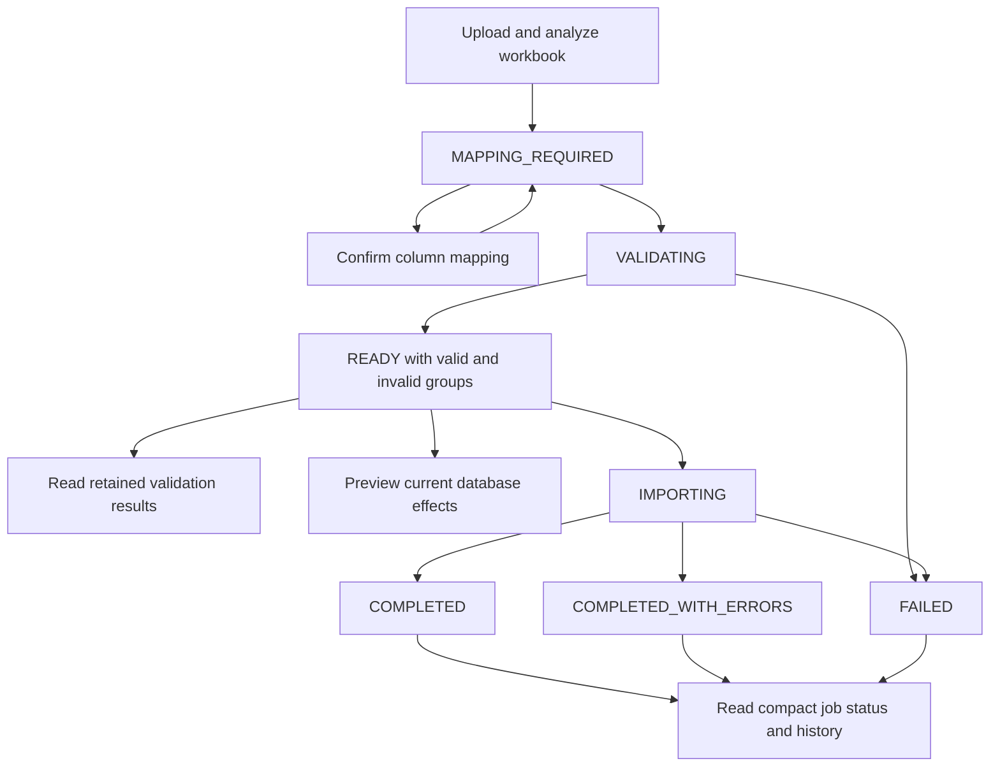

# Excel import workflow

Imports are synchronous, business-scoped Product/Variant operations. The
[Imports API](imports-api.md) retains detailed schemas and examples; the
[Android handoff](android-excel-import-handoff.md) retains client serialization
examples until Swagger coverage is verified.

## Lifecycle

The job is created as MAPPING_REQUIRED after successful analysis. UPLOADED,
ANALYZING and CANCELLED exist in the enum but do not imply public upload-progress
or cancel APIs. Mapping confirmation stays MAPPING_REQUIRED. Validate and execute
claim their expected state atomically; only one competing request proceeds.

## Upload, sheet and mapping

The owner uploads one `.xlsx` file, at most 10 MiB, with optional sheetName.
Analysis defaults to the first sheet, detects a header in the first fifty rows
and returns sheet names, selected header, samples and a job ID. Choosing another
sheet requires a new upload; clients cannot override headerRow. Analysis counts
non-empty data rows, while later validation counts physical rows and reports
blank ones as skippedRows.

Suggestions are advisory. Confirm name and externalKey mappings. Each source
column is mapped once; duplicate/blank headers need the one-based source index.
STANDARD, ATTRIBUTE, VARIANT_ATTRIBUTE, IGNORE and UNMAPPED have distinct rules.
IGNORE/UNMAPPED target is explicitly null, not merely omitted. Attribute targets
use safe lowercase keys; option names use their separate trimmed-name rules.

One row represents one Variant. The trimmed, case-sensitive externalKey groups
rows into a Product within a Business; SKU is a separate Variant identity. All
rows in a Product group must agree on Product metadata, including mapped blanks.
A conflicting/invalid row excludes its group. Names alone are never identity.
Set a manual Product's externalKey before importing its code.

No option columns means a simple Product/default Variant. Configurable rows
require all selected options and a SKU. Identity is Product code plus exact
option combination; JSON key order does not change it. Duplicate combinations or
SKUs invalidate affected groups. A SKU cannot move between combinations. Import
may extend allowed values, but does not convert simple/configurable Products,
rewrite old combinations, remove unimported definitions or reactivate records.
Use separate workbooks for simple/configurable layouts.

## Validation, results and preview

Validation rereads the retained workbook and scoped database state without
writing Products/stock. Successful processing reaches READY even with invalid
groups. Inspect validRows/invalidRows and summaries instead of treating READY as
“all rows valid.” Suggestions/confirmed mapping become locked by validation.

Validation-results GET reads the version-2 saved snapshot. It does not rerun the
workbook. Old version-1/missing/unavailable snapshots return
IMPORT_VALIDATION_RESULTS_UNAVAILABLE, not invented replacement results.
Corrupt/read-failing snapshots use a safe server error.

Preview requires READY, rereads the workbook and current database, and writes
neither catalog nor stock. Inserts/updates/unchanged count Variant rows, not
distinct Products. Existing identities include productId, its catalogItemId
alias and variantId. A new Product/Variant can have no ID yet. A category change
can contain a UUID or a `{ "create": "Category name" }` value; do not decode it
as a UUID unconditionally. Preview can differ from the retained validation
snapshot and is not a lock or execution guarantee.

## Execution and transaction boundaries

Execution claims READY-to-IMPORTING and rereads the workbook/state. Each Product
group uses a serializable transaction, advisory identity lock for first creation
and scoped parent Product locking. Category, Product, all group Variants, stock
changes and movement audits commit together or roll back together. Other groups
can succeed independently. Uniqueness races become controlled conflicts.

Category text is whitespace-normalized/case-insensitively resolved within the
Business; an absent category is created in the group transaction. Imports do
not accept foreign Category UUID references. Blank category preserves existing
links. Nonblank mapped attributes merge without erasing unmapped fields.

Price cells must be valid nonnegative decimals. Blank Variant price inherits on
creation and preserves the existing override on update; explicit PATCH null is
a different operation. Nonblank stock is an absolute set through InventoryService,
enables tracking and records INITIAL_IMPORT/IMPORT_UPDATE. Blank/unmapped stock
preserves existing stock/tracking; imports never disable tracking. New Variants
without stock are untracked/null. Unchanged rows avoid unrelated timestamp writes.

Execution returns complete, unpaginated result arrays. COMPLETED means no
invalid/failed rows; otherwise successful processing ends COMPLETED_WITH_ERRORS.
Group conflicts record EXECUTION_CONFLICT; other rolled-back group failures use
ROW_EXECUTION_FAILED. Infrastructure/workbook/job failure attempts to persist
FAILED with accumulated counters/errors; earlier committed groups remain.

Missing workbook metadata in execution returns **409 IMPORT_WORKBOOK_UNAVAILABLE**
with `The import job has no retained mapped workbook`. The outer catch records
failure but preserves this specific exception. Unexpected execution failures
return **500 IMPORT_EXECUTION_FAILED** with `Import execution could not be completed`.
If failure recording itself cannot reach the database, final status persistence
cannot be promised. The HTTP error never proves that earlier groups rolled back.

## Pagination and client recovery

History defaults to twenty items; validation-results and preview default to
fifty rows. Limits are 1–100, offsets are nonnegative safe integers, and unknown
query fields are rejected. Row readers page one combined sequence of valid and
invalid non-skipped rows by rowNumber, then split collections. Limit does not
apply separately to each returned array. Summaries cover the whole workbook.

After a timeout, read compact status/history before acting. Those responses
expose counters and timestamps, not private file keys, mappings or full errors.
Completed/failed jobs cannot be remapped/replayed; use a corrected new upload.
Stable codes/combinations preserve identity, but explicit stock in a new job can
replace stock changed since the previous job. Blank stock is safer for metadata-only
reimports. Do not blindly reset a stuck IMPORTING job to READY.

## Files and operational limitations

Workbooks and validation sidecars use LocalImportFileStorage under IMPORT_STORAGE_DIR
or `.storage/imports`. Failed analysis attempts remove its saved workbook;
validation failure attempts to remove a newly saved snapshot. Successful job
files are retained; there is no general expiry policy, permanent object store or
durable worker. A filesystem path is not persistence across redeploys/replicas.

A process exit can leave IMPORTING and stale counters. Investigate committed
groups/audits before owner-approved recovery. No automatic crash takeover,
partial execution selection, file-hash deduplication, cancel API or resumable
execution is implemented. See [deployment](deployment.md) and
[error recovery](api-errors.md).
